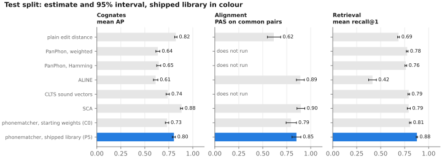

# phonematcher documentation
<!-- agent-hint
covers: the list of every documentation page in reading order
source: docs/*.md
generated: no
verify: pytest --import-mode=importlib tests/test_docs.py -k test_the_index_lists_every_page
see: ../README.md, quickstart.md
-->

phonematcher measures how far apart two sounds or two IPA words are, and finds words that sound alike.

<picture>
  <source media="(prefers-color-scheme: dark)" srcset="img/test-split-dark.svg">
  
</picture>

The [Benchmarks](benchmarks.md) page gives every value of this figure.

## Quickstart

```bash
uv pip install --prerelease=allow phonematcher
```

```python
from phonematcher import feature_distance, ipa_distance, segments

feature_distance("ʁ", "χ")       # 0.013
segments("ˈt͡ʃɐ̃w̃")              # ['t͡ʃ', 'ɐ̃', 'w̃']
ipa_distance("ˈpojʃ", "ˈpojs")   # 0.199
```

## Pages

These pages teach phonematcher in the order below. The first seven are walk-throughs: each step shows real output. The last five are reference.

| Page | What you get |
|---|---|
| [Quickstart](quickstart.md) | Install, turn words into IPA, and run one distance and one search. |
| [Compare two sounds](compare-sounds.md) | The distance between two segments, and the features behind the number. |
| [Compare two words](compare-words.md) | The edit distance, the alignment of two words and the normalized distance. |
| [Tones](tones.md) | How a tone is written, compared and priced against a sound. |
| [Search by sound](search.md) | An index of terms, a query, and what the sensitivity changes, with benchmark numbers. |
| [Use with scikit-learn](scikit-learn.md) | A distance matrix for a clusterer, and feature rows for a pipeline. |
| [Add a segment](add-a-segment.md) | An entry with its source, the rebuild of the table and the test. |
| [The feature table](features.md) | The 40 features, their weights and sources, every change to PanPhon, how marks, ties and tones read, and the distance formula. |
| [Segments](segments.md) | What one segment is: the base letter, the marks around it, tie bars, tones, length and boundaries, each with a real input and output. |
| [Design choices and limits](design.md) | The contested choices, their alternatives, sources and evidence, and what does not read. |
| [API reference](api.md) | Every public name. |
| [Benchmarks](benchmarks.md) | Every result file, rendered, for phonematcher and the systems it is compared with. |

The [whitepaper](../whitepaper.md) gives the method and the evidence as one paper: the feature table, the costs, the pre-registered test and its limits.

[Index](index.md) · Next: [Quickstart](quickstart.md)
